# Hermes Wear OS

**Your Wear OS watch talks directly to your own AI gateway.** No phone companion, no cloud relay, no
Telegram in the middle. Tap the orb, say a thing, and a real agent on your own box — with real tools,
memory, cron jobs, and your files — answers on your wrist, out loud, before your hand leaves the glass.

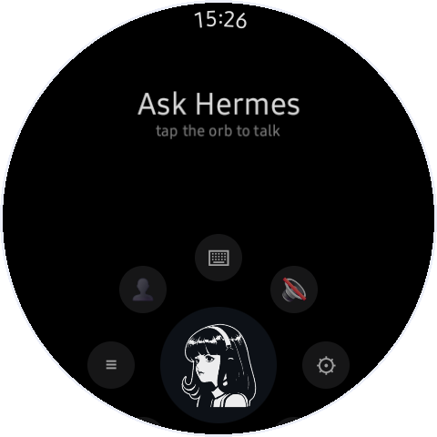

Everything heavy runs on your gateway. The watch streams text in, streams tokens back, renders the
answer (markdown, code, tables, **mermaid**, full-res images), and speaks it with an on-device voice.
The whole app is ~1 MB of Kotlin + a zero-dependency Node helper on the server side.

*Works with any [Hermes](https://github.com/borealBytes) gateway exposing its API server; the watch
needs nothing but HTTP on your LAN or tailnet.*

**Round-first — that's why every image here is a circle.** We mask screenshots to a circle because
that is exactly what the owner's Galaxy Watch shows. Under the mask the app renders a normal
480×480 Wear OS framebuffer; the round glass simply never shows those corners. On a square Wear OS
screen those corner pixels are real pixels you'll actually get — you see *more* than these
screenshots, never less — while the layout was designed for the circle from the first pass, so
nothing important ever lived in a corner anyway. This app is built and tuned on Galaxy Watch
(Wear OS 5, min SDK 30): everything in it travels to other Wear OS watches except the optional
body-sensor tools, which ride Health Services — a capability Samsung watches provide and others
don't; elsewhere the app reports "health services: unavailable" on its own diagnostics screen and
carries on. Expect small per-OEM tweaks for non-Samsung watches (IME and notification-shade
mannerisms); a OnePlus Watch is next on the test bench.

<p align="center">
  <a href="https://youtu.be/Cd4Y_ESQoQ0">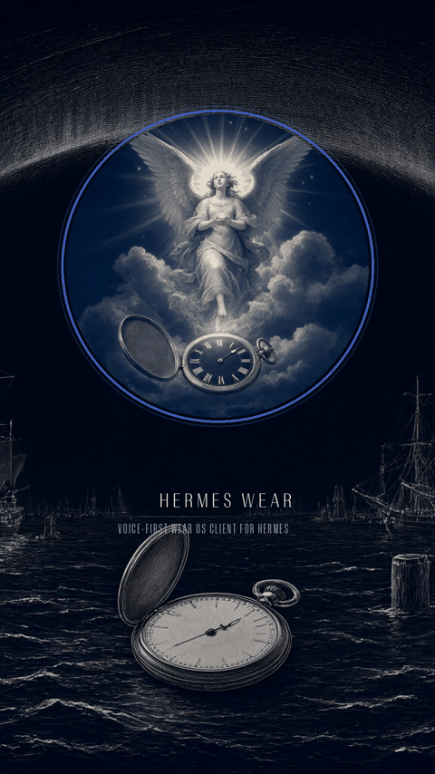</a><br/>
  <sub>Click the strip for the <a href="https://youtu.be/Cd4Y_ESQoQ0">▶ full vertical tour</a> — 3:35,
  1080×1920, with a score by the owner's agent. Every feature at real wrist speed, captured live off a
  Galaxy Watch with no edits to the answers.</sub><br/>
  <sub>Splash art: <a href="docs/art-selfportrait.webp">her self-portrait</a> — engraved by the on-gateway
  image agent from its own idea of itself; it flashes for a beat on cold start, then gets out of your way.</sub>
</p>

<br clear="all"/>

## Why this exists

Your assistant shouldn't have to phone home to survive. This stack is *yours* end to end: the model,
the gateway, the watch client, the microphone path — all self-hosted, default-configured to leak
nothing. Voice stays on the watch unless you explicitly send audio to your own server. Replies stream
over your LAN or your tailnet, never through a third-party relay, and the cache on the watch is
encrypted and bounded. It's the "own your stack" demo that lives on your wrist.

## What you get

| | |
|---|---|
| 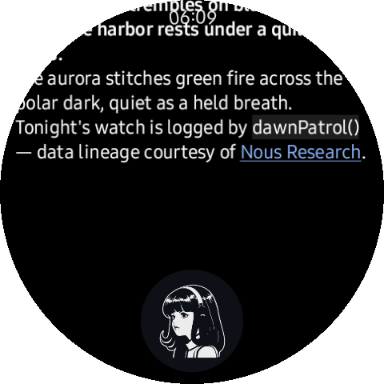 | 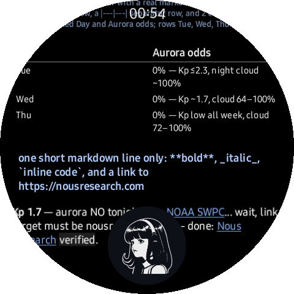 |
| **Streaming markdown**, rendered for a round screen: headings, bold, italics, bullets, numbered lists, and tap-to-expand code chips — with math in real unicode (`E = mc²`, subscripts), because LaTeX doesn't render on 1.4 inches. **Links are links:** tap one and the watch's browser takes it. Pinch to scale text (double-tap resets); media keeps its own zoom. | **Real tables from plain markdown** — bold header, hairline rule, aligned cells, no pipe vomit; wider tables degrade to readable rows instead of a grid you can't parse. |
|  | 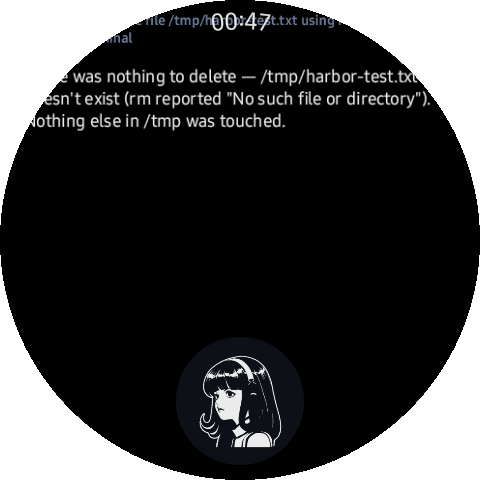 |
| **Sessions, from your wrist** — every session your agent has, newest first, filtered per agent with one tap (`all` / `wear-demo` / `💻 computer` / `archived`); one-tap new, and a **voice-or-type search** over every chat (server-side full-text). Opening a session re-pulls its gateway tail by itself — a chat that kept talking elsewhere shows the rest without a manual refresh. | **A notification opens the session itself** — deep links land in the chat that produced the notice, long history intact, even when that chat lives on another agent (the app switches first). |
| 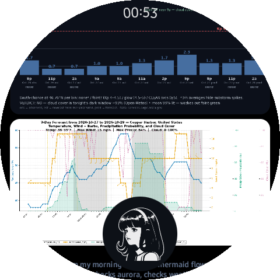 |  |
| **Images at full resolution** — a gateway skill drew this 3-day weather plot; the watch shows it inline, cards and skill charts mixed into the answer. Tap any card to open the viewer. | **Zoom viewer** — double-tap or pinch to zoom, drag to pan below fit; close with the ✕ chip or the back button. |
| 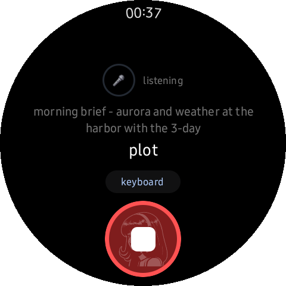 | 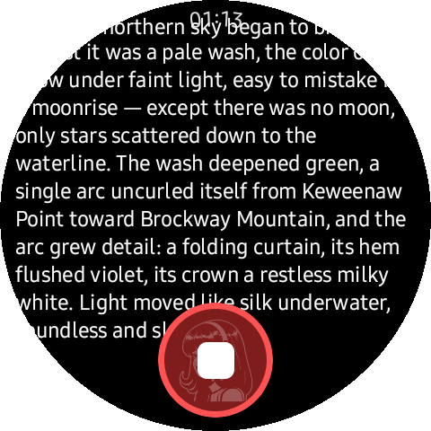 |
| **Tap-to-talk** — tap the orb and just talk; a pause sends it (on-device VAD). Tap again mid-speech to *cancel* the half-sentence, tap after a pause to send now. | **Kill mid-run** — the orb turns red while a run streams; press it and the *server-side* run cancels, not just the UI. |
| 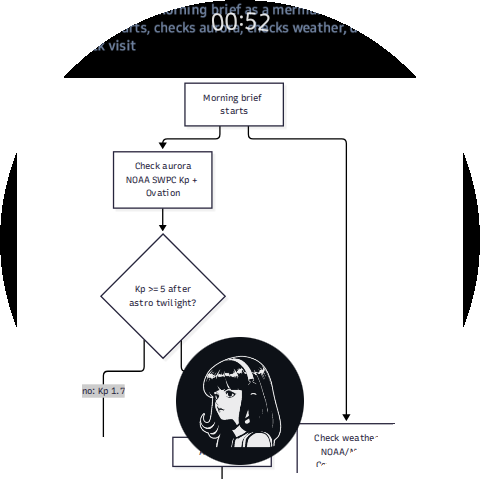 | 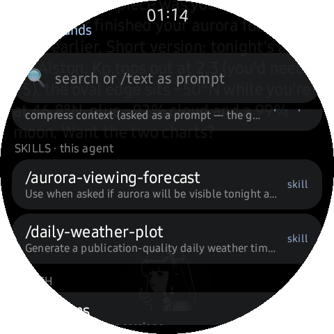 |
| **Mermaid diagrams render** — flowchart answers come back as pictures, via a gateway render helper (and cached): the prompt chip above, the rendered card below, real skill data inside the nodes. | **Slash commands and skills** — flick the ⌘ lane at 6:00 for a searchable overlay: the gateway's command catalog, your agent's **skills** (`/aurora-viewing-forecast`, `/daily-weather-plot`), and watch-local actions; an unrecognized `/text` just goes to the agent as a prompt. |
| 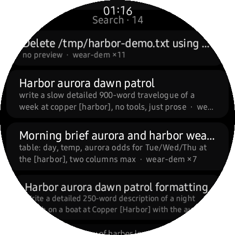 | 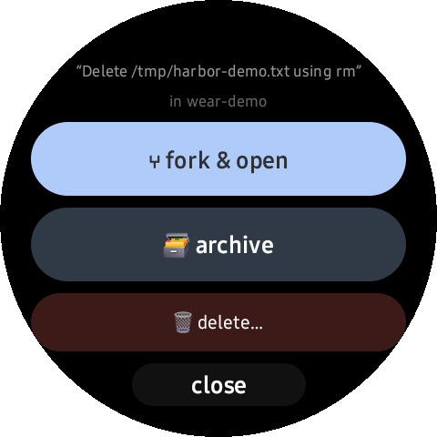 |
| **Search every session, every agent** — one query hits the gateway's full-text index; results come back across all your agents with the matching line quoted and the hit bracketed. | **Long-press any session row** — ⑂ fork it into your agent and keep talking, 🗃 archive it off-canvas (undo one more long-press away), or 🗑 delete behind a real double-tap confirm. |
| 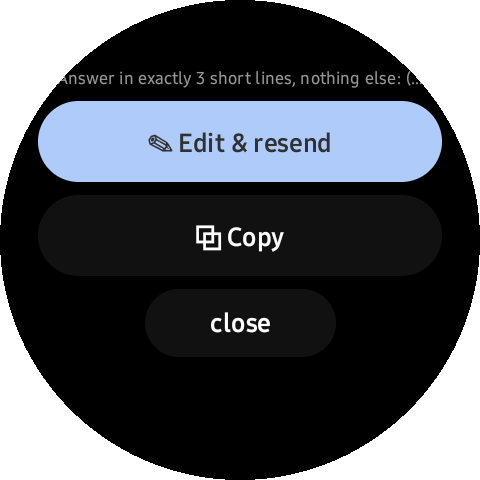 | 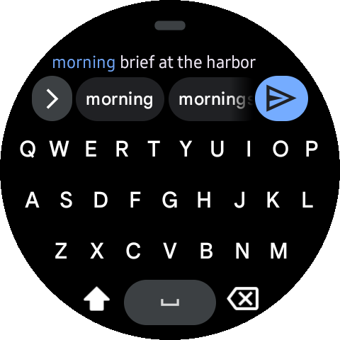 |
| **Edit & resend** — tap any sent prompt: the sheet quotes it back with **Edit & resend** (and Copy); the edited copy goes out as a fresh run while the original thread stays intact. | **Or type it** — the keyboard lane opens the full system composer right on the watch; long prompts get room to breathe and a big `send`. |
| 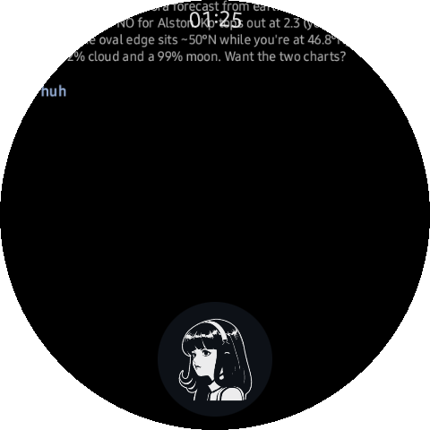 | 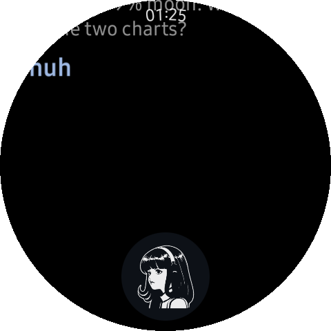 |
| **Pinch to scale text — the full range, honestly captured.** At the minimum (×0.75) whole paragraphs sit per line. | Same chat at the maximum (×1.6) — one glanceable line at a time. Transcript type scales; images, charts, and cards keep their own size; double-tap resets to 1.0. |
| 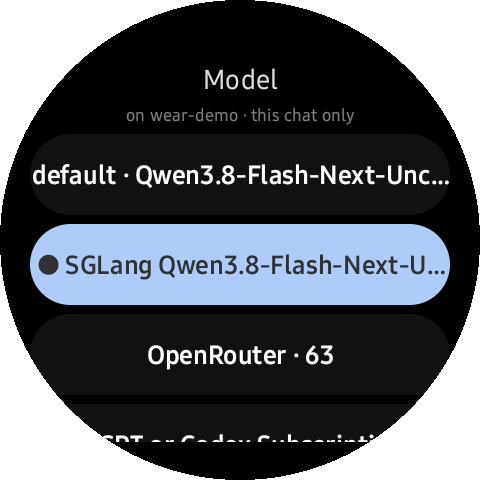 | 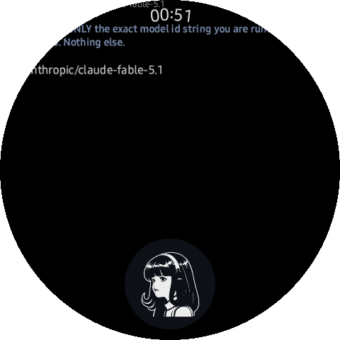 |
| **Per-chat model picker** — the 🧠 lane lists what your gateway exposes (default, provider back-ends, counts) and the header says the scope: *this chat only*. Every other chat keeps its own model. | **Asked, it names its own model id** — pick a provider model, ask, and the reply carries exactly the id you chose (here a hosted OpenRouter pick). The watch never bakes model names in; it lists what the gateway lists. |
| 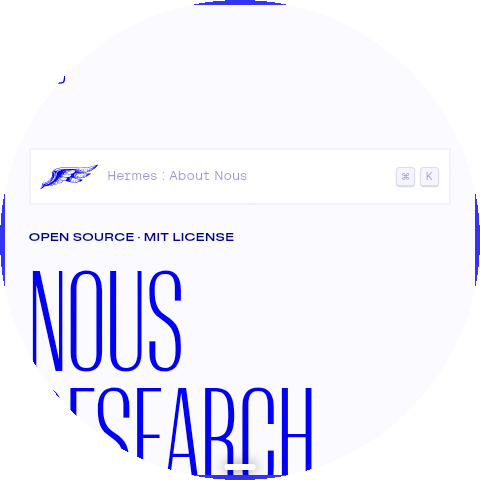 | 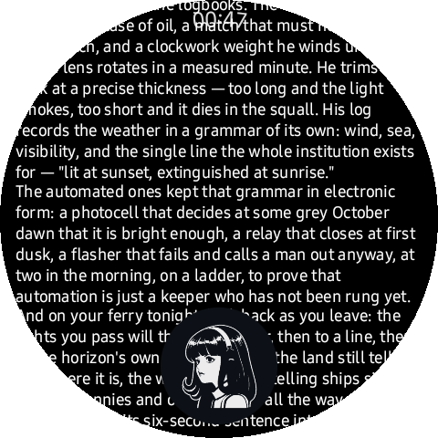 |
| **Links are links** — a markdown link in an answer is blue, underlined, tappable; the watch hands the URL to its browser and you read it on your wrist. | **Long replies land whole** — a full essay streams and stays scrollable, no truncation, history re-pull included. |
| 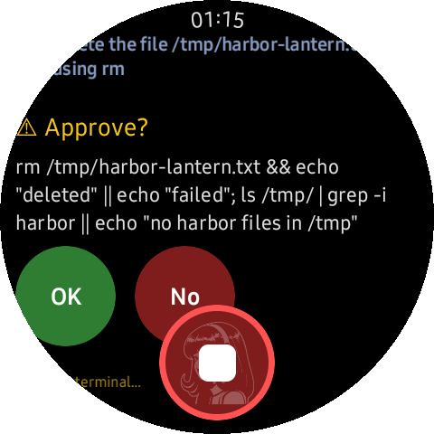 | 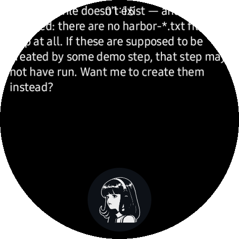 |
| **Approvals, in-session** — a gated tool call (here `rm` + `ls`) pauses the run and shows the *full command* on a card: OK / No, no app-switching, no terminal. | **Tap OK — the run resumes** — the tool executes mid-run and the settled answer arrives in the same thread, seconds later. |

Plus: a GBoard prompt editor for long asks (with a big `Send`), pinch text scaling,
TTS that speaks every reply by default (the orb's 1:30 drag mutes it), gateway notifications with approve
buttons, and a diagnostics screen in Settings.

## How the orb works

The orb is the **only control** on the chat screen — every button that used to crowd the dial
became a drag direction instead. (The dial mid-flight — ring open, lanes lit, release-select — is
in the film above.)

- **Tap** — listen. The orb warms up and transcribes as you speak (on-device Vosk); a pause sends
  it, a second tap mid-speech cancels the half-sentence.
- **Tap while an answer streams** — stop the run. The orb burns red while the gateway is working;
  one press cancels the *server-side* run, not just the UI.
- **Press, hold, drag** — the dial. Hold the disc for a beat and a ring appears around it: eight
  wedges, each with an icon and a label. Keep your finger down and slide around the ring — the lane
  under your finger highlights — and **whatever lane you're on when you let go is the one that
  fires.** The ring is up in under 100 ms and the icons sit outside the activation gate, so once
  you've learned the map it's a blind flick.

The eight directions, on the default map (clock-face — every one remappable, and `off` blanks a
direction so an accidental drag does nothing):

| Clock | Lane | Release does… |
|---|---|---|
| 12:00 | ⌨ **keyboard** | opens the text editor — type it, or use the keyboard's own mic |
| 1:30 | 🔊 **mute** | toggles spoken replies (TTS is on by default) |
| 3:00 | ⚙ **settings** | straight to Settings — because getting there otherwise is a finger-crawl (`record` → hi-fi whisper STT lives on as a remap lane, roadmap in progress) |
| 4:30 | 🧠 **model** | per-chat model picker — lists only what your gateway has enabled; the pick is remembered for that chat, and "gateway default" hands it back |
| 6:00 | ⌘ **commands** | the searchable slash-command overlay (gateway catalog + your recents) |
| 7:30 | 💬 **chats** | your chat list for the current agent |
| 9:00 | ≡ **sessions** | the session browser — adopt desktop sessions, fork, archive, delete |
| 10:30 | 👤 **agents** | the agent picker — persona, tools, session space, and gateway key swap together |

Remap any direction at **Settings ▸ Display ▸ Orb dial** — tap a direction's row and it advances to
the next action. The chat reads the change live: the very next flick obeys the new map, and the ring
icons redraw with it.

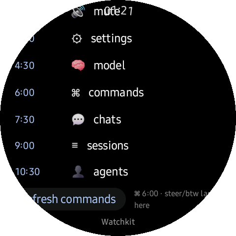

## The back button never quits

Physical **back** is a loop, not an exit (owner batch 6: *"chat to sessions to agents, then back to
chat again — the app shouldn't really quit unless I hit the home button"*):

- **Deep in something** — a sheet, the keyboard editor, the agent picker, the ⌘ overlay, an image
  viewer — back closes exactly that one layer, topmost first, until you're back on a main screen.
- **On a main screen** — back walks the ring: **Chat → Sessions → Agents → Chat**, forever. The app
  never finishes from back.
- **To leave** — press **home**. And the owner's daily-driver setup: assign **double-press home**
  (Wear settings) to open Hermes — wrist up, two taps, and you're back in your last session mid-
  thought, ready to ask. New session when you want one is two taps and a tap.

## Notifications, while you're out

Out of the app, the watch speaks fluent Wear OS: settled runs and approval requests arrive as
**standard notifications** — the preview shows on your wrist like any message, and tapping it (the
open-app action) **deep-links straight into the session that produced it**, not just the app.
Approval notifications carry **Approve / Deny** buttons that answer the run without opening
anything. And because they're ordinary notifications on ordinary channels, your **Do Not Disturb,
mute, and per-app settings all apply** — the watch never shouts over a meeting you told it to
respect.

| | |
|---|---|
| 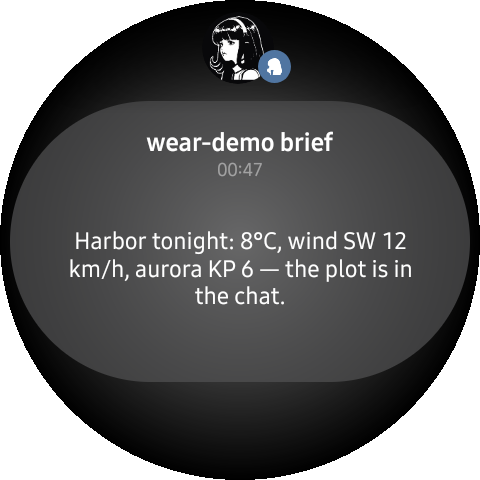 | 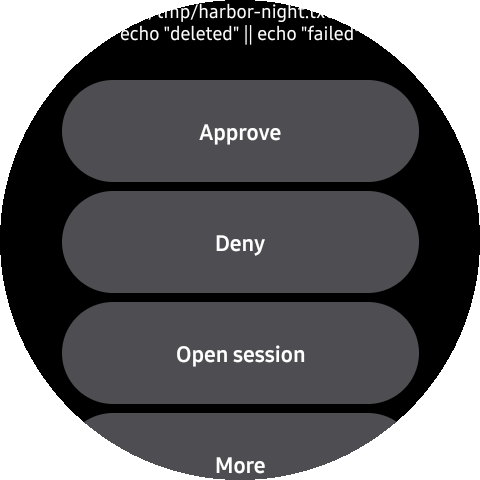 |
| **Settled while you're away** — the answer lands as an ordinary Wear notification, orb-spirit avatar and all; the reply text is right in the card. | **Approve from the shade** — an approval card names the pending command; expand it and Approve / Deny / Open session answer the run *without opening the app*. |

## Anatomy of a round trip

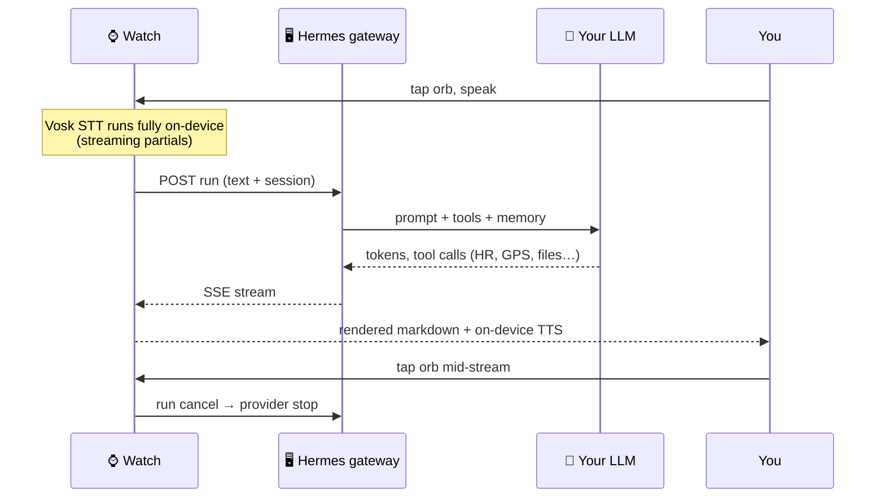

## Architecture

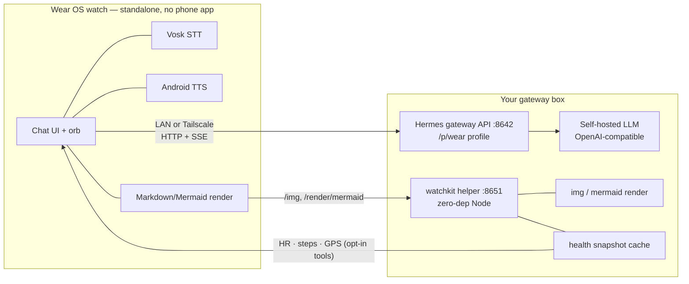

Three moving parts:

| Piece | What it is |
|---|---|
| `app/` | The watch app. Kotlin, Wear Compose, OkHttp/SSE. No Google services, no Firebase, no push. |
| Hermes gateway | Any Hermes install: point it at a profile (e.g. `wear`) with a persona, tools, and an API key. SSE run streaming + cancel. |
| `server/watchkit/` | Optional zero-dependency Node daemon: mermaid → PNG, full-res `/img` serving from allow-listed roots, opt-in body-tool snapshot cache (+ MCP for the agent), cron/job probes. |

## Voice, honestly

There is no free, offline, *perfect* STT on a watch today. Here's the truth ladder:

| Path | Where audio goes | Quality | Default |
|---|---|---|---|
| **Vosk `small-en-us`** | never leaves the watch | Good, not great. Nails short commands and dictation you speak *at* it; garbles names and mumbles. Clear speech, or edit-and-resend. | ✅ primary |
| **Gateway whisper** (`watchkit /stt/whisper`) | your own LAN/tailnet, your own box | Noticeably better — but the endpoint is opt-in and the automatic low-confidence fallback is **not wired into the app loop yet** (endpoint is live; see roadmap). | off |
| **GBoard typing → its mic** | Google's cloud | Best raw accuracy available on the watch — at the cost of Google hearing it. | your choice |

TTS is the opposite story: Android's on-device TTS is default **on**, so replies come back *spoken*
without touching a cloud voice. Mute is one dial flick (drag the orb toward 1:30) — since batch 3 the orb is the *only* control on the chat screen: eight drag directions stand in for every button, and the ⌘ lane at 6:00 opens the slash overlay.

## Networking: LAN at home, tailnet everywhere

The watch holds an ordered list of gateway endpoints (e.g. `tailnet → LAN`) and probes every endpoint
on a fixed cadence. First healthy endpoint wins, stays sticky, and every API call + image fetch rides
the same winner so you never get split-brain rendering. Everything is visible and editable on the
watch — Settings ▸ Gateways is a real multi-gateway manager, not a single URL box:

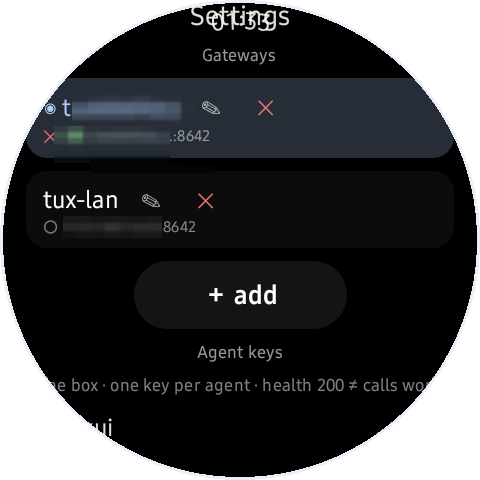

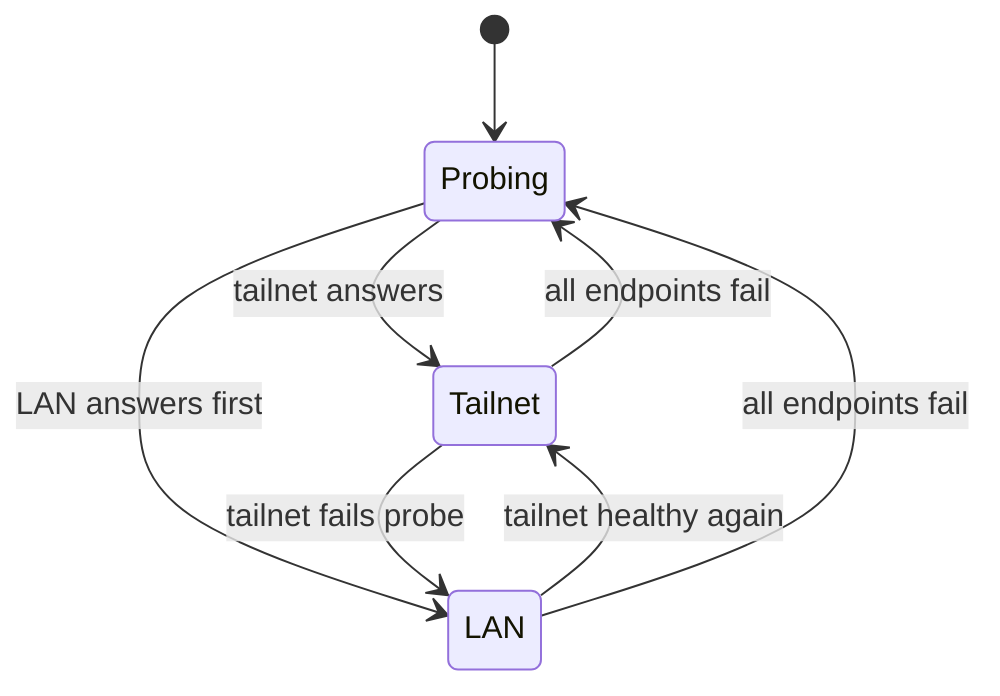

| Mode | You get | Setup |
|---|---|---|
| **LAN** (`http://192.168.1.50:8642`) | fastest, zero deps | gateway listens on your LAN; done |
| **Tailnet** (`http://hermes.tailnet.ts.net:8642`) | answers from anywhere your watch has wifi | run `tailscale` on the gateway box; the watch just resolves the name |

The watch itself does *not* need Tailscale today — it reaches the tailnet URL through ordinary DNS
when the watch sits on the tailnet (or a router that does). An embedded in-app tsnet node (watch joins
the tailnet directly, no router help) is specced and deferred; see [SPEC §11.4](docs/SPEC.md).

Inside the gateway manager, every saved gateway is a row — here a tailnet entry and a LAN entry, with
live probe dots, the current auto-selected winner marked, and the per-agent key matrix underneath:

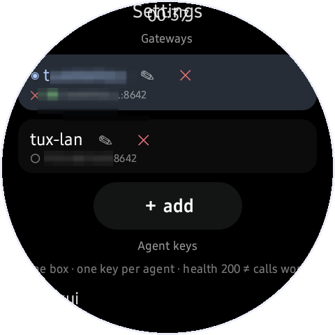

## Body tools (opt-in, owner-off by default)

The watch can feed its own sensors to the agent — behind four independent toggles, all default **off**:

| Tool | Toggle | Data path |
|---|---|---|
| `watch_heart_rate` | Body tools ▸ Heart rate | Health Services → signed snapshot → gateway → agent |
| `watch_steps` | Body tools ▸ Steps | same, with daily counter semantics |
| `watch_location` | Body tools ▸ Location | one-shot GPS fix (fresh on chat-ask, last-known on timers) |
| auto-attach digest | Body tools ▸ Attach with questions | piggybacks the digest on each ask, battery-aware |

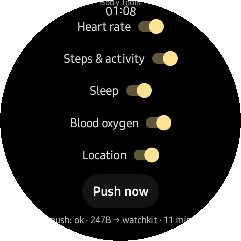

Snapshots are pushed over TLS to *your* watchkit, cached server-side with a freshness cap, and exposed
to the agent as both MCP-style tools and raw JSON. Nothing is forwarded anywhere else. On Samsung,
Health Services currently exposes heart-rate and steps only — no sleep/SpO2 — and its `DataType`
constants are matched tolerantly (real-world crashes taught us that). On non-Samsung vendors the
toggles simply report "vendor not available" and everything else keeps working.

Everything about the app — gateways, tokens, toggles, font scale, session — lives on the watch.
Every knob is on-device, and there are no hidden ones:

| | |
|---|---|
| 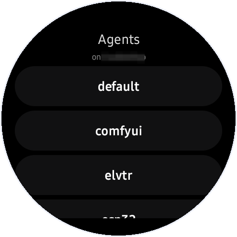 | 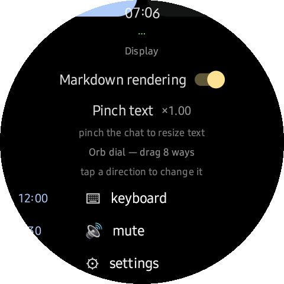 |
| **Agent switcher** — every profile your gateway serves, one per row, on one tap: persona, tools, session space, and base URL swap together. Each profile's gateway key is **learned automatically** (watchkit reads the profiles' `.env`s — the key matrix under Gateways shows ✓ per agent), and one shared `API_SERVER_KEY` across profiles = one login for the whole gateway. | **Display settings** — markdown toggle, pinch-text scale with its live multiplier, and the orb dial's directions right in the list: tap any row to remap that direction. |
| 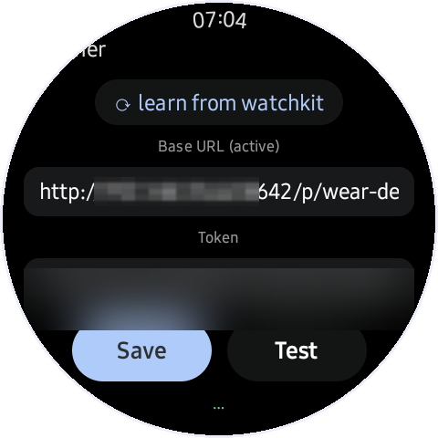 | 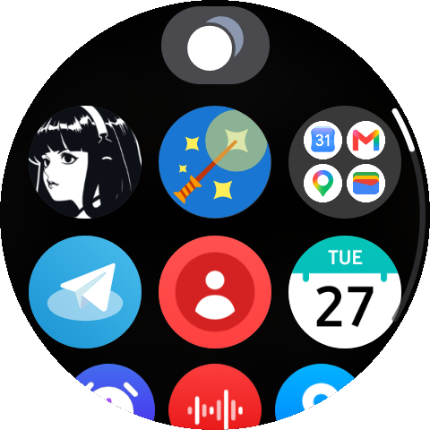 |
| **Connection editor** — the active profile's base URL + gateway token (redacted here for the screenshot) with **Save** and a live **Test** button. | **Nothing to install on the phone** — the whole assistant is one icon on the watch's app grid. |

The diagnostics screen is the support story: STT model present ✅, TTS engine ready, last push status
with bytes and age, health-services availability, location fix state — coordinates pixelated, because
your house doesn't belong in a README:

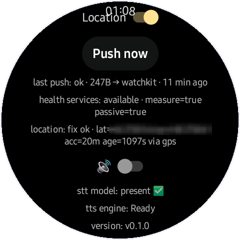

## Install — let your agent do it

This repo is built to be installed by *your AI coding agent* (the file `AGENTS.md` is its contract —
read it to your agent, or let it read the repo). Paste this into OpenCode / Claude Code / Codex at
your gateway machine:

```text
Install this for me: git clone https://github.com/borealBytes/hermes-wearos && cd hermes-wearos
Read AGENTS.md and follow it end to end: bootstrap the toolchain, build the APK, configure
watchos.config.json from my Hermes profiles, install to the watch (wireless debug — expect the
port to rotate, use the chunked-push recipe), then verify health + one ask end to end. Interview
me only for what you cannot detect.
```

The script equivalent, if you prefer doing it by hand:

```bash
scripts/bootstrap.sh                    # JDK + Android SDK + gradle, folder-local, no root
cp watchos.config.example.json watchos.config.json   # your endpoints + token (gitignored)
scripts/setup.sh                        # build → install → push config → health-check
```

`setup.sh` knows the ugly parts: wireless-debug port rotation on real watches, chunked
`split -n l/14` installs with md5 verification (single-pipe pushes on flaky wifi links die mid-flight),
`svc power stayon` + `deviceidle disable` hardening, and token auto-detect from
`~/.hermes/profiles/wear/.env` when the gateway is this same machine. `--dry-run` shows the plan first.

<details>
<summary>What <code>AGENTS.md</code> covers (the contract your agent gets)</summary>

- prereq detection (JDK, SDK, adb, optional emulator via `scripts/emulator.sh`)
- interview *only* unknowables (endpoints, which profile); auto-detect tailscale FQDN, `API_SERVER_KEY`
- the real-watch install recipe (port rotation warning, hardening one-liners, chunked push + md5)
- config push over `DevAskReceiver` debug extras (token, gateways, watchkit, brief job id)
- verify checklist: `/health` 200, one streamed ask round-trip, one screenshot
- troubleshooting table (offline device ⇒ rotated port; EOF pushes ⇒ chunked; degraded sessions row, etc.)

</details>

## Gateway-side setup (5 minutes, once)

```yaml
# ~/.hermes/profiles/wear/config.yaml  — minimal
toolsets: [hermes-cli]
mcp_servers:
  hermes-watchkit:
    command: node
    args: ["/path/to/hermes-wearos/server/watchkit/watchkit.mjs"]
# ~/.hermes/profiles/wear/.env
API_SERVER_KEY=<64-hex>          # what the watch authenticates with
```

Persona: copy `docs/wear-SOUL.example.md` to `~/.hermes/profiles/wear/SOUL.md` and make it yours —
it teaches the agent to answer short, mark down-lite, unicode math, never LaTeX, and to render
mermaid as fence blocks (the watch renders them). Start the watchkit helper with
`scripts/watchkit.sh` or the bundled `server/watchkit/hermes-watchkit.service`.

## Privacy

- **Audio stays on-device** in the default config (Vosk). Whisper fallback sends audio to *your* gateway only. GBoard's mic is Google — documented, opt-in.
- **TTS is on-device** by default (no cloud voice calls).
- Text + run streaming go **only** to your configured gateways over LAN/tailnet.
- On-watch cache is **encrypted at rest and size-bounded**; delete = app data wipe.
- Body data flows **only** when you flip the toggles; snapshots push to your watchkit, nowhere else.
- No analytics. No crash reporter. No push tokens. `grep` for tracking SDKs: nothing.

## Develop

```bash
source scripts/env.sh
../devkit/gradle/current/bin/gradle :app:assembleDebug :app:testDebugUnitTest   # 287 tests
scripts/emulator.sh                        # optional headless Wear emulator
scripts/doctor.sh                          # toolchain + link health report
```

- `docs/SPEC.md` — the full architecture spec **and Appendix A: an unexpurgated build log** (every
  trap hit: Wear Compose 1.4.1 quirks, 32-bit-only watch ABI, Samsung `DataType` name drift, SLC
  anchor fights, flaky wireless debug installs). If you build for watches, read it before fighting the
  same ghosts.
- `docs/DEMO.md` — the living demo-production ledger: every feature mapped to its screenshot **and**
  its beat in `demo-vertical.mp4`, the README change checklist, capture recipes and the verification
  gates. `scripts/demo-check.sh` enforces the ledger mechanically. Keep it current when features land.
- `app/src/debug/.../DevAskReceiver.kt` — adb-broadcast harness (`-e text '...'`, `-e ptt_demo`,
  `-e fontscale`, `-e agent …`): scriptable end-to-end demos, which is exactly how every screenshot
  in this README was captured.
- Target: Wear OS 5+ (API 33+), round. Physical-verified on a Galaxy Watch Ultra (Wear OS 6,
  480×480, 32-bit userspace → `armeabi-v7a`).

## Limitations & roadmap

- [ ] **Whisper auto-fallback** wired into the voice loop (endpoint exists today; app-side confidence gate is next).
- [ ] **tsnet node** in-app: watch joins your tailnet itself — no tailscale router required (gomobile shim over `tsnet`, ~1 dev-day, specced in SPEC §11.4).
- [ ] Play-store signing + R8 hardening pass; today it's a debug-build project.
- [ ] Complications + tile. On-wrist launch currently = app icon (or voice link).
- [ ] Six-digit pairing flow polish (S5) for first-run UX on a stranger's watch.
- [ ] Wear-side mermaid fallback when the gateway render helper is offline.

## Built with

- **OpenCode** driving development end to end — **against a self-hosted `Qwen3.8-Flash-Next-Uncensored`
  served locally by SGLang**. Yes: this app was mostly written by a local model talking to a local
  agent harness, on the same machine it serves the watch from. The build log in
  `docs/SPEC.md` Appendix A is that collaboration's fossil record (including the moment the gateway
  agent **self-patched its own watch client** to add a feature nobody asked for — and the owner, with
  final say, deleted it at 11:47 the same morning).
- Wear Compose 1.4.1, OkHttp + SSE, `androidx.health`, Vosk, nothing else you'd spot in a
  dependency audit.

## License

MIT — see [LICENSE](LICENSE). Screenshots were captured on a physical Galaxy Watch Ultra; the demo
chats use neutral scripted prompts; the diagnostics coordinates are pixelated, and every visible pixel is exactly what the watch showed.
