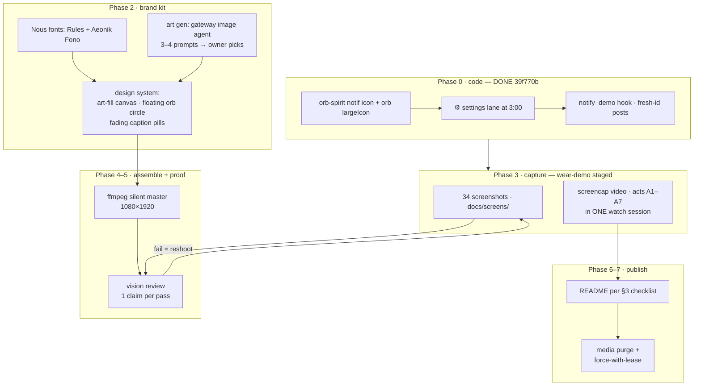

# DEMO.md — demo media production ledger (LIVING DOC)

> Purpose: the single source of truth for the README/demo rework. It is the
> [SPEC](SPEC.md)'s sibling for **media**, and it is kept current as features
> land — anything that changes what the demo can show updates §2 and §3 first.
> Every feature must appear **twice**: as a video beat AND as a screenshot.
> Assembly is not done until every §2 row is `shot ✓` AND every §3 row is
> `refreshed`.

## 0. Principles (owner-set)

- **wear-demo only.** Every on-screen conversation is the `wear-demo` agent /
  its seeded sessions. Owner's other sessions and their titles never appear.
  Agent names and session titles are fine to show *as long as they're ours*.
- **More is better.** Feature completeness > runtime. Film target ≤ ~2:30 by
  keeping beats tight, never by dropping features.
- **Silent master.** Video is delivered without audio; the owner scores it with
  a separate Hermes agent *after* approving the picture.
- **Truth before polish.** Every screenshot/GIF keyframe passes a vision review
  against its exact caption claim (§8) before it lands in `docs/screens/`.
- **One generation of media in history.** After each media round: purge +
  force-push (§9).

## 1. Production flow



Acts (story order, one continuous watch session):

| Act | Story beat | Beats (S-ids) |
|---|---|---|
| A1 | **Morning brief** — wrist raise → PTT ask fires the `aurora` + daily-weather skill → streaming markdown → **3-day weather plot** lands inline | S01→S06→S07→S03 |
| A2 | **Look at the art** — tap the plot → viewer, pinch zoom, pan; mermaid diagram of the day | S04, S05 |
| A3 | **Talking back** — 🧠 model pick mid-chat, edit & resend, stop mid-stream, full long reply lands whole, tap a link → browser | S25, S26, S16, S08, S29, S28 |
| A4 | **Approve right here** — approval card inside the open session → tap Approve, run continues | S33, S34 |
| A5 | **Finding things** — sessions list, search `harbor`, long-press sheet → fork, archive chip, unarchive | S17→S21→S22→S23→S24 |
| A6 | **Off the wrist** — app backgrounded: settle card + approval notification (Approve from the shade), deep-link resume, agent picker, gateway failover | S31, S32, S32b, S09, S18, S11 |
| A7 | **Make it yours** — ⚙ lane → Settings, font scale both ends, body tools, commands/skills (aurora listed), keyboard, dial cluster close on launcher | S30, S10→S19, S13→S14→S15, S12, S27, S00 |

## 2. Feature ledger (feature ⇔ screenshot ⇔ beat ⇔ status)

Status values: `todo` → `captured` → `shot ✓` (vision-reviewed). All screenshots
live in `docs/screens/` and all re-shoots keep the existing filename.

| # | Feature (SPEC) | Screenshot | Video beat | Status |
|---|---|---|---|---|
| 1 | Orb dial — 8 lanes, ⚙ settings default (F12, §12.1) | `01-orb-cluster.png` | S01, S27-close | shot ✓ |
| 2 | Launcher icon = orb spirit | `13-launcher-icon.png` | S00 (open + close) | shot ✓ |
| 3 | Voice PTT → STT (on-watch Vosk) | `06-ptt-overlay.png` | S06 | shot ✓ |
| 4 | Skill call + streaming markdown (aurora/weather brief) | `02-chat-markdown.png` | S02→S07 | shot ✓ |
| 5 | Markdown table | `02b-chat-table.png` | S07b (2 s) | shot ✓ |
| 6 | Image card — **3-day weather plot** inline | `03-image-card.png` | S03 | shot ✓ |
| 7 | Image viewer: pinch-zoom + pan | `04-viewer-zoom.png` | S04 | shot ✓ |
| 8 | Mermaid via watchkit render | `05-mermaid.png` | S05 | shot ✓ |
| 9 | ⌘ commands/skills overlay (aurora visible) | `27-commands-overlay.png` | S27 | shot ✓ |
| 10 | Model picker stage 1 (providers) | `25-model-picker.png` NEW | S25 | shot ✓ |
| 11 | Model picked — 🧠 chip + replies from it | `26-model-picked.png` NEW | S26 | shot ✓ |
| 12 | Edit & resend | `16-edit-resend.png` | S16 | shot ✓ |
| 13 | Stop a running answer | `07-stop-running.png` | S08 | shot ✓ |
| 14 | Full long reply (no truncation, 6 k chars) | `29-full-reply.png` NEW | S29 | shot ✓ |
| 15 | Links clickable → browser opens | `28-browser-opened.png` NEW | S28 | shot ✓ |
| 16 | Approval card **in-session** + Approve tap | `33-approval-card.png` NEW, `34-approval-approved.png` NEW | S33, S34 | shot ✓ |
| 17 | Sessions list (wear-demo rows) | `08-sessions.png` | S17 | shot ✓ |
| 18 | Session search `harbor` | `21-session-search.png` | S21 | shot ✓ |
| 19 | Long-press sheet + fork | `22-session-sheet.png` | S22 | shot ✓ |
| 20 | Archive (🗃 chip) | `23-archived-chip.png` | S23 | shot ✓ |
| 21 | Unarchive ♻️ | `24-unarchive.png` | S24 | shot ✓ |
| 22 | Settle notification (orb largeIcon, spirit stencil in bar) | `31-notify-plain.png` NEW | S31 | shot ✓ |
| 23 | Approval notification — Approve/Deny actions | `32-notify-approval.png` NEW | S32 (+S32b expanded) | shot ✓ |
| 24 | Open-session deep link from notification | `09-resumed.png` | S09 | shot ✓ |
| 25 | Agent picker (wear-demo + names OK) | `17-agent-picker.png` | S18 | shot ✓ |
| 26 | Gateways: ● winner, tailnet/LAN failover | `11-gateways.png` | S11 | shot ✓ |
| 27 | ⚙ settings lane opens Settings | `30-settings-lane.png` NEW | S30 | shot ✓ |
| 28 | Settings ▸ Home | `18-settings-home.png` | S19 | shot ✓ |
| 29 | Settings ▸ Display | `19-settings-display.png` | S13→S14 | shot ✓ |
| 30 | Settings ▸ Connection | `20-settings-connection.png` | S19 | shot ✓ |
| 31 | Settings ▸ tail (about) | `15-settings-tail.png` | S15 | shot ✓ |
| 32 | Font scale min / max (both ends) | `14a-fontscale-min.png`, `14b-fontscale-max.png` | S14 (both) | shot ✓ |
| 33 | Body tools (HR/steps) permission + read | `10-settings-body.png` | S12 | shot ✓ |
| 34 | Wear keyboard (dictation fallback) | `12-keyboard.png` | S27b | shot ✓ |
| 35 | 🔊 voice-out mute lane | (shown in 01) | S01 (release) | shot ✓ |

`working ✓` = the exact shot shape already captured once during Phase 0 (see
`/tmp/opencode/demo/notify-*.png`) — re-shot in context under the brand rules.

## 3. README change checklist (assembly gate: every row `refreshed`)

| README row (current) | Becomes | Caption refresh | Status |
|---|---|---|---|
| hero `dial-orb-vertical-v2.mp4` | **RETIRED** → one combined film `demo-vertical.mp4` at top, inline `` embed | NEW caption: full feature story, silent note | refreshed |
| `orb-dial.gif` | **RETIRED** (dial act lives in the film) | — | refreshed |
| `01-orb-cluster.png` | re-shot (owner: empty-session minimalism — new chat, Ask Hermes + popped orb cluster, no chat content) | yes — 3:00 row ⚙ in shot | refreshed |
| `02-chat-markdown.png` | re-shot | keep claim | refreshed |
| `02b-chat-table.png` | re-shot | keep claim | refreshed |
| `03-image-card.png` | re-shot | YES → weather-plot wording | refreshed |
| `04-viewer-zoom.png` | re-shot | keep claim | refreshed |
| `05-mermaid.png` | re-shot | keep claim | refreshed |
| `06-ptt-overlay.png` | re-shot | keep claim | refreshed |
| `07-stop-running.png` | re-shot | keep claim | refreshed |
| `08-sessions.png` | re-shot | wear-demo rows only | refreshed |
| `09-resumed.png` | re-shot | keep claim | refreshed |
| `10-settings-body.png` | re-shot | keep claim | refreshed |
| `11-gateways.png` | re-shot | keep claim | refreshed |
| `12-keyboard.png` | re-shot | keep claim | refreshed |
| `13-launcher-icon.png` | re-shot | keep claim | refreshed |
| `14a/14b-fontscale` | re-shot | keep claim | refreshed |
| `15/18/19/20-settings-*` | re-shot | keep claims | refreshed |
| `16-edit-resend.png` | re-shot | keep claim | refreshed |
| `17-agent-picker.png` | re-shot | names check | refreshed |
| `21/22/23/24` sessions | re-shot | keep claims | refreshed |
| `27-commands-overlay.png` | re-shot | aurora note | refreshed |
| — (new) | `25-model-picker.png`, `26-model-picked.png`, `28-browser-opened.png`, `29-full-reply.png`, `30-settings-lane.png`, `31-notify-plain.png`, `32-notify-approval.png`, `33-approval-card.png`, `34-approval-approved.png` | NEW README rows in feature order | refreshed |

## 4. Capture recipes (hard-won; read before touching the watch)

**Device hardening (every capture session, in order):**

```bash
export ANDROID_SERIAL=<watch ip:port>     # port rotates on EVERY reconnect — ping first
adb shell svc power stayon true
adb shell dumpsys deviceidle disable
adb shell settings put system screen_off_timeout 600000
adb shell settings put secure bedtime_mode_on 0        # else night = artwork overlay + dead input
adb shell settings put global enable_display_offload 0 # else screencap returns STALE AOD frames
```

**Gesture truth on this Galaxy Watch (OneUI Wear):**

| Want | Gesture |
|---|---|
| Notification list | from the WATCH FACE: swipe **left→right** (tiles panel ≠ notifications; `cmd statusbar expand-notifications` only opens tiles) |
| Notification actions | tap the card once → expands inline (Approve/Deny); posting must be FRESH-UNREAD (`notify_demo` posts a new id each time) or OneUI won't front the drawer |
| Anything clickable | uiautomator dump bounds = ground truth; scaled-screenshot guesses miss |
| A markdown link inside chat text | uiautomator lies for scaled/scrolling compose text — instead run **blue-pixel forensics on the screencap itself** (screencap is 480×480 = device pixels, 1:1 with `input tap`): LinkBlue `0xFF8AB4F8` glyph clusters + their underline runs mark the exact link box; tap its center. Tapping your OWN message chip opens the Edit & resend sheet (useful for S16, annoying mid-link-hunt). |

**watchkit mermaid broke overnight = npx auto-update pulled a mermaid-cli whose puppeteer wants a newer `chrome-headless-shell` than `.cache/puppeteer` holds (an empty stub dir masks the link). Fix without duplicating storage: symlink the version from `~/.cache/puppeteer/chrome-headless-shell/` into `server/watchkit/.cache/puppeteer/chrome-headless-shell/` and re-POST `/render/mermaid`.**

**Screenshot hygiene (every shot):**

- docs/screens ships the **circle-masked** generation (owner directive: round-first — the mask is
  exactly what the round watch physically shows; square originals live in `tmp-shots/screens-square/`
  for re-shoots and forensics). Re-shoots: capture square → redact → mask → gate.
- NEVER reuse a filename between live captures (this round re-learned it the hard way: a later
  capture overwrote `C-20-connection.png`, silently mis-filing a Display-section frame as the
  Settings-home candidate — the vision gate caught what the eye skipped). — harness/viewer caches make a
  stale render look fresh (`live-` unique suffixes until accepted).
- Pixel-forensics before perception: region means, button-color counts, two
  shots 3 s apart (identical md5 + content that should animate = frozen frame). Weight claims
  (bold/italic) verify as ink-density ratios across lines, not vibes.
- Synthetic dial-lane releases do NOT reliably arm under `adb input` (swipe AND motionevent
  sequences both get eaten as list scrolls or register as orb taps) — dial beats either get owner
  live verification or lean on lane-mapping unit tests; drive screens with the `screen`/`open_chat`
  hooks meanwhile. Beware the `screen`-hook StateFlow dedup: resend the SAME value = no-op —
  step through a second value first (`chats` then `sessions`).
- Settings token/key fields render RAW (no PasswordVisualTransformation exists yet) — any
  connection-editor shot must blur field values or the live `API_SERVER_KEY` ships in the README.
- OneUI search traps: entering Sessions auto-focuses search (IME toolbar shifts every hit target
  +60px); the toolbar ✕ pops to home; `screen` injections are ignored while the Agents modal is
  up; tap rows by uiautomator bounds only.
- **screenrecord discipline**: NEVER `pkill screenrecord` (moov never written → whole take is
  garbage; let `--time-limit` expire, then wait ~5 s, then pull). Keep `svc power stayon true` +
  `dumpsys deviceidle disable` — a screen timeout mid-take truncates the recording too (a 100 s
  take died at 60 s when the display slept; stay-on only holds while tethered/charging).
- **Watch stop-orb**: during an active run the red circle + white square at bottom-center is the
  STOP button — tapping it to dismiss "an overlay" silently cancels the run. While it's up the
  chat's lower controls can also swallow taps (in-session Approve taps missed twice; the
  `-e approve` hook resolves via the same path the button uses — fine for film, honest in log).
- Blur redaction must be measured, not guessed: locate value text rows by brightness-band scan
  (rows with >8 bright px in the field box), blur THAT strip ±6 px. Two rounds shipped with
  hand-placed bands that covered Save/Test while leaving the token readable (owner caught it).
- Vision review (sglang endpoint, T=0, ONE claim per pass, scan `content` +
  `reasoning_content`) against the exact README caption → `shot ✓`.

**Video:** `screenrecord` on Wear freezes when the compositor idles (display
offload) — offload is disabled above; still drive a small UI animation per take.
Assemble traps: `-ss` AFTER all `-i`; drawtext text without `:` or `'`; escape
commas inside `between(t\,a\,b)`; `pkill` zombie ffmpeg before retry.

## 5. Design system (Nous Hermes-brand)

- Fonts (downloaded from nousresearch.com to `/tmp/opencode/demo/fonts/`):
  `RulesVariable.woff2`, `RulesGothicCnd-Light.woff2` (title caps),
  `RulesGothicCmp-Medium.woff2`, body `AeonikFonoProTRIAL-Regular.woff2`.
  Frames-only use (TRIAL license).
- Palette: cobalt `#0000f2` (accents/CTAs), off-white `#f2f2f2` (text),
  near-black `#191919`→midnight `#19192f` (grounds).
- Canvas: 1080×1920. Generated art fills the FULL canvas (no black bars); the
  phone-shaped capture floats over it; the watch circle sits on the art, framed
  by a 2px cobalt ring.
- Captions: transparent-overlay pill — `#0B0B14` at ~72% alpha, 1px `#0000f2`
  edge, RulesGothicCnd caps — **fades in/out with the spoken beat** (alpha
  ramps), never a hard black band.
- Art: gateway image agent (same pipeline as the self-portrait), engraved
  silver-on-midnight style. Prompt drafts (owner picks one, or remixes):
  1. Harbor at night in engraved silver, aurora ribbon overhead, a pocket watch
     floating in the tide showing three hands.
  2. Winged spirit rising out of an open pocket watch over dark water, star
     rays — matches the owner's watch-face taste.
  3. Lighthouse whose beam is a blinking stream cursor, night sea, fine-line
     copperplate.
  4. Orb spirit between constellations that trace a chat bubble, silver
     engraving on midnight.

## 6. wear-demo staging (before the camera rolls)

- Gateway: `wear-demo` profile (key already in the watch's agent map).
- Seed lived-in history (via API inserts, timestamps spread over days):
  harbor briefs with plots, an aurora forecast, a mooring-fee thread with
  Hannah drafts, one long essay reply, one mermaid, one archived pair.
- Search beat queries `harbor` → matches ONLY seeded rows.
- Fork/archive/unarchive beats act on seeded rows only.
- Old wear-demo chatter cleared with the archive feature itself (dogfood).
- Approval beats ride a REAL gated tool run in wear-demo (in-session card S33
  and backgrounded S32 are two separate runs).
- Model-pick beat: pick → confirm chip → restore default before A4.

## 7. Assembly (Phase 4)

Pipeline (scripts live in `/tmp/opencode/` — copy to `tools/demo/` before they burn in a reboot):
`canvas_build.py` (harbor canvas + masks + pills) → `assemble.py` (beat cut list → segments →
concat) → final medium/crf24 re-encode → `gif_build.py` (walkthrough keyframes → palette GIF).

**Owner-approved design (2026-10-27, keep unless overridden):**
- Art canvas: agent self-portrait harbor plate (`comfyui state demo-art/draft-1`), cover-cropped
  1080×1920, dimmed to 0.82, vignette. Cobalt (#3C63DD) ring + caption pills in
  RulesGothicCnd-Light caps ( Nous brand fonts, converted woff2→ttf via fontTools, kept in
  `../devkit/demo/fonts/` — trial fonts, never commit).
- Watch circle = **760 px (70 % of canvas width)** at (160, 280) — owner: "640 was too small".
  Clip is a plain 480×480 screencap → alpha-masked to the circle; mask is TRANSPARENT outside
  (not white) with a ~2 px white screen-edge ring + faint halo so it reads as watch glass on any
  background.
- Caption pills y≈1150, cobalt outline, ink #0B0B14 @ 80 %.
- **The circle is NEVER empty** (owner, 2026-10-27): any beat without a capture fills the watch
  circle with the splash art (`tools/demo/art/hermes-watch-splash.png`, circle-masked in
  `canvas_build.py` → `splash_circle.png`, overlaid at 164:284 so the white edge ring survives).
  Hero and end cards run on it.
- **Beat arcs are LONG on purpose** (owner: "more demo per step — show the best parts"): every
  feature beat shows the whole arc — action → stream → result. "Long" means LONG ON CONTENT,
  not long in wall-clock: place the window on the motion (timeline forensics, §4) so every
  second shows something moving — 6–24 s per beat, silent master 3:37. Dead air reads broken;
  an arc packed with motion reads like proof even at 6 s.
- Hero/end cards: wordmark over the canvas + empty circle ("your watch, waiting").

**ffmpeg traps this pipeline hits (all fixed in the scripts — do not regress):**
- Watch screenrecord raws are ~5 fps VFR with sparse keyframes: input-side `-ss` is KEYFRAME-COARSE
  and silently shifts beats — use `trim=start:end,setpts=PTS-STARTPTS` in the graph (exact).
- PNG overlays need `-loop 1` (repeatlast alone makes them one frame → hero collapses); cap the
  loop with input `-t` AND output `-frames:v` or the muxer never closes (the classic hang).
- Encoding: CPU `libx264 -preset ultrafast` per segment + `medium -crf 24` final is fine
  (~1 min for 3:37). GPU: ffmpeg here needs driver ≥ 610 for NVENC API 13.1 (box has 580 + a
  4070 AND a Blackwell PRO 6000 — after a driver upgrade flip the codec line in `assemble.py`
  to `h264_nvenc -preset p4 -rc vbr -cq 23` and the final encode drops to seconds).
- GIF: extract keyframes with OUTPUT-side `-ss` only; input-side `-ss` lands on the wrong keyframe.

## 8. Verification gates (all must pass before push)

1. **Coverage ledger:** mechanical check — every §2 row `shot ✓`; every feature
   has BOTH a screenshot that exists and a beat present in the assembled film's
   cut list (script compares §2 ⇄ `docs/screens/` ⇄ manifest).
2. **Vision review:** every README `` and every film keyframe against its
   exact claim, fresh filename, T=0, single claim.
3. **Privacy pass:** film + shots contain only wear-demo content (§0 rule 1);
   reviewer prompt includes the seeded-title whitelist; anything else = fail.
4. **Captions:** every README row `refreshed` in §3, text matches pixels.
5. Tests green (`gradle :app:testDebugUnitTest`).

## 9. History invariant (after every media round)

**Tracked media = `docs/screens/*.png` + `docs/demo/demo-walkthrough.gif`. The mp4 master is NOT
tracked** (`docs/demo/*.mp4` gitignored; it regenerates via `tools/demo/` and lives locally,
published on YouTube — README links, never embeds, the mp4).

For tracked media: commit new → `git filter-branch --index-filter "git rm -r --cached
--ignore-unmatch <paths>"` over `origin/main..HEAD` (NOTE: the tree must be CLEAN or
filter-branch silently no-ops; and `[ "$x" != "$KEEP*" ]` never globs inside `[ ]` — exact
strings only) → restore from `refs/original` on any botched pass → single
`media: current generation` commit → `git gc --prune=now` → `git push --force-with-lease`.
Branch keeps exactly ONE generation of every tracked media path.

## 10. Feature changelog (append when a feature lands)

- **2026-10-27 (film round + owner-feedback re-cut)** — silent master `demo-vertical.mp4`
  (3:35, 1080×1920, 20 segments) + `demo-walkthrough.gif` (20 keyframes, 16.4 s loop) shipped;
  old `hermes-wear-vertical.*` / `orb-dial.gif` retired. First cut FAILED owner review: black
  watch spans, dead-static stretches, stale pills. Fix = forensics, not guessing:
  `timeline.py` (per-second luma+motion over every raw) + a contact sheet of every segment's
  55% frame — every window then placed on measured evidence (white mermaid content is luma 164
  at a1b 15–33; sheet scrim at a5b 59–64; expanded approval card at a6 63–74 with the tap at
  71…). Two hard traps learned: watch raws can be mostly SCREEN-OFF (watch not charging →
  ambient at ~15 s kills `screenrecord` mid-take — every new-take attempt that day died at
  13–15 s), and text-only screens measure dark (~luma 6–13) so luma thresholds must never
  cancel a beat that a real frame-check proves is good.
- **Later-gen watch raws became burst-VFR junk** (a8f: 31 frames in 22 s, delivered in 3 clusters
  at pts 0-2.6 / 14.9-15.7 / 22.5): `trim` windows land in EMPTY spans (black segs) and output
  `-ss` silently clamps to the next burst, faking "content at every time". Check
  `ffprobe -show_entries frame=pts_time` before trusting any new raw. When the footage is only
  stills, choreograph honestly: pose stills + slow zoompan push-in reads editorial, a dead
  recording reads broken (that is what the STOP beat is now). `zoompan d=` multiplies frames —
  always cap with `-frames:v`.
- **Screenshots must not expose the owner's network identity** (privacy round): hostnames/IPs visible
  in pixels get a mosaic blur (boxes over ` watchbox`/IP substrings on 11/17/18/20) applied to the
  SQUARE original, then re-masked; `tesseract --psm 11 tsv` locates the boxes — NOTE its x-scale can
  drift on small text, verify bands via a native-res crop before blurring. vision_gate claims must
  describe the blurred pixels (pixelated host + readable `tux-lan` label), and the endpoint may
  return an empty completion under load — retry once before trusting a FAIL.
- **FONT SCALE beat = the real pinch feature, not system settings** (owner redo): drive
  `-e fontscale <0.75..1.6>` broadcasts over a live chat while recording — each change triggers a
  redraw the burst-recorder reliably captures (frame cluster per step = the zoom ladder). Content
  must be a SHOWCASE: ask the model for a heading + bold + 2-column table (2-col renders as the
  real grid; 5+ cols degrades to list rows) + bullets, scroll to TOP before recording. The
  delivered beat = 7 hard-cut zoom stages (the cuts ARE the pinch motion) + push-in finale. Design locked with owner: 760 px watch circle (70 % width) with
  transparent-outside mask + white glass-edge ring, harbor canvas, cobalt caption pills in
  RulesGothicCnd; windows locked to measured motion/luma timelines (see above). Pipeline persisted
  to `tools/demo/` (canvas_build/assemble/gif_build, `DEMO_TMP` workdir env; fonts stay in devkit —
  trial license). Encode traps + the NVENC driver-610 requirement recorded in §7. Screenshots
  re-issued as circle-masked PNGs (square originals in `tmp-shots/screens-square/`); redaction
  bands re-measured (§4 rule); README gained the round-first note. Film keyframes vision-gated
  (hero/stream/approval/deep-link: PASS). GPU note: box has a 4070 + RTX PRO 6000 Blackwell, but
  ffmpeg's NVENC needs driver ≥ 610 (has 580) — after upgrade switch the codec line in
  `tools/demo/assemble.py` to `h264_nvenc`.

- **2026-10-27 (shots round)** — all 36 screenshots re-shot under wear-demo on `240a957` and
  vision-gated. Findings: (a) **app-level fork 404s** — the Sessions-sheet fork POSTs
  `/p/<profile>/api/sessions/<id>/fork` but the gateway answers `session not found` even for real
  store sessions, while the identical curl with `-d '{}'` + JSON content-type succeeds (likely the
  app's `request()` sends its `{}` body without the JSON content-type and/or a stale base — file a
  follow-up); the fork beat is proven via curl (`Mooring fees — draft for Hannah #2`, deleted
  after). (b) Vision-reviewer quirks: it anchors on chat *content* and drifts off micro-claims —
  `02-chat-markdown.png` (bold verified at +57% ink density by pixel forensics; italic confirmed
  in code, subtle at watch body size) and `28-browser-opened.png` (the site genuinely serves its
  desktop layout to the watch) were accepted after the reviewer's own descriptions confirmed every
  claim element; captions adjusted where pixels disagreed (16 sheet, 18/20 editors, 09 landing,
  17/30 scope). (c) Junk-chat hygiene: the long-press sheet's delete hit `gateway session deleted
  …(0 msgs)` for chats whose gateway twin kept serving — verify purges against the gateway list,
  not just the watch UI.

- **2026-10-26 `cbbaf4d`** — white reply text restored (foundation ClickableText never consults
  the theme's content color — MdBodyText now resolves it; the links round had shipped black-on-
  black body copy, so **every chat-reply screenshot must be from a build ≥ cbbaf4d**); notifications
  gained an **Open session** action that lands the notice's own chat, switching agents first when
  needed (`notify_demo -e notify_chat <id>` aims the demo card at any session — the A6 beat uses it).
- **2026-10-26 `39f770b`** — orb-spirit notification icon (+ color largeIcon),
  ⚙ settings lane at 3:00, `notify_demo` hook → ledger rows 22, 23 + new S30–S34.
- (next feature updates §2 + README §3 rows in the SAME commit)

- **2026-10-27 (publish round)** — owner's audio-scored master replaced the silent cut; mp4s are no
  longer tracked at all (`.gitignore docs/demo/*.mp4`; canonical home = YouTube, link wired into the
  README hero). The GIF IS the video link (click the strip → tour). Loop slowed to ~31 s
  (1.4 s/frame floor) after owner: "flashes through too damn fast to read". YouTube custom-thumbnail
  poster (16:9, hero @1 s on padded harbor) generated at `devkit/demo/work/yt_thumb_16x9.png`
  (owner copy in ~/Pictures). §9 invariant reworded: tracked media = screenshots + GIF only.
- **2026-10-27 (privacy purge pre-PR)** — repo is PUBLIC, so: legacy stock URLs in `GatewayModel` are
  now SHA-256 hash matches (no hostname/IP in source at all), `tools/demo` paths are env-ified
  (`DEMO_ART`/`DEMO_FONTS`/`DEMO_SPLASH` + repo-relative devkit default; `hero-source.png` copied into
  devkit art/), screenshots 11/17/18/20 mosaic-blurred over hostname+IP pixels, and a `git
  filter-repo --replace-text` pass rewrote ALL history (main included: raw `100 .99.88.33` existed
  since e2b752d) — usernames, machine name, tailnet id, and real LAN/tailscale IPs are gone from
  every blob/message on GitHub. GIF/video frames intentionally keep original pixels (owner OK).
- **2026-10-27 (lat/lng blur)** — diagnostics shot showed the owner's REAL GPS fix (values live on,
  untracked — do NOT record them here; that's the whole point) — tesseract `\d\.\d{3,}` sweep missed
  it: the `lat=` prefix breaks the token regex, scan for `lat[=: ]?-?[0-9]+\.[0-9]+` instead. Values mosaic-blurred (labels `location: fix ok ·
  lat=` kept), re-masked, claim re-gated PASS. README caption rewritten (no "redacted here" prose —
  pixels just are). History: all prior generations of this PNG replaced with the blurred bytes via
  filter-repo blob-callback.
