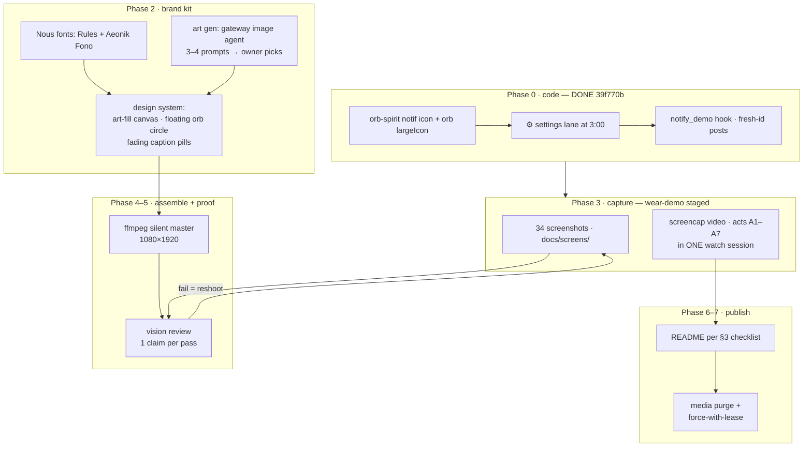

# DEMO.md — demo media production ledger (LIVING DOC)

> Purpose: the single source of truth for the README/demo rework. It is the
> [SPEC](SPEC.md)'s sibling for **media**, and it is kept current as features
> land — anything that changes what the demo can show updates §2 and §3 first.
> Every feature must appear **twice**: as a video beat AND as a screenshot.
> Assembly is not done until every §2 row is `shot ✓` AND every §3 row is
> `refreshed`.

## 0. Principles (owner-set)

- **wear-demo only.** Every on-screen conversation is the `wear-demo` agent /
  its seeded sessions. Owner's other sessions and their titles never appear.
  Agent names and session titles are fine to show *as long as they're ours*.
- **More is better.** Feature completeness > runtime. Film target ≤ ~2:30 by
  keeping beats tight, never by dropping features.
- **Silent master.** Video is delivered without audio; the owner scores it with
  a separate Hermes agent *after* approving the picture.
- **Truth before polish.** Every screenshot/GIF keyframe passes a vision review
  against its exact caption claim (§8) before it lands in `docs/screens/`.
- **One generation of media in history.** After each media round: purge +
  force-push (§9).

## 1. Production flow



Acts (story order, one continuous watch session):

| Act | Story beat | Beats (S-ids) |
|---|---|---|
| A1 | **Morning brief** — wrist raise → PTT ask fires the `aurora` + daily-weather skill → streaming markdown → **3-day weather plot** lands inline | S01→S06→S07→S03 |
| A2 | **Look at the art** — tap the plot → viewer, pinch zoom, pan; mermaid diagram of the day | S04, S05 |
| A3 | **Talking back** — 🧠 model pick mid-chat, edit & resend, stop mid-stream, full long reply lands whole, tap a link → browser | S25, S26, S16, S08, S29, S28 |
| A4 | **Approve right here** — approval card inside the open session → tap Approve, run continues | S33, S34 |
| A5 | **Finding things** — sessions list, search `harbor`, long-press sheet → fork, archive chip, unarchive | S17→S21→S22→S23→S24 |
| A6 | **Off the wrist** — app backgrounded: settle card + approval notification (Approve from the shade), deep-link resume, agent picker, gateway failover | S31, S32, S32b, S09, S18, S11 |
| A7 | **Make it yours** — ⚙ lane → Settings, font scale both ends, body tools, commands/skills (aurora listed), keyboard, dial cluster close on launcher | S30, S10→S19, S13→S14→S15, S12, S27, S00 |

## 2. Feature ledger (feature ⇔ screenshot ⇔ beat ⇔ status)

Status values: `todo` → `captured` → `shot ✓` (vision-reviewed). All screenshots
live in `docs/screens/` and all re-shoots keep the existing filename.

| # | Feature (SPEC) | Screenshot | Video beat | Status |
|---|---|---|---|---|
| 1 | Orb dial — 8 lanes, ⚙ settings default (F12, §12.1) | `01-orb-cluster.png` | S01, S27-close | todo |
| 2 | Launcher icon = orb spirit | `13-launcher-icon.png` | S00 (open + close) | todo |
| 3 | Voice PTT → STT (on-watch Vosk) | `06-ptt-overlay.png` | S06 | todo |
| 4 | Skill call + streaming markdown (aurora/weather brief) | `02-chat-markdown.png` | S02→S07 | todo |
| 5 | Markdown table | `02b-chat-table.png` | S07b (2 s) | todo |
| 6 | Image card — **3-day weather plot** inline | `03-image-card.png` | S03 | todo |
| 7 | Image viewer: pinch-zoom + pan | `04-viewer-zoom.png` | S04 | todo |
| 8 | Mermaid via watchkit render | `05-mermaid.png` | S05 | todo |
| 9 | ⌘ commands/skills overlay (aurora visible) | `27-commands-overlay.png` | S27 | todo |
| 10 | Model picker stage 1 (providers) | `25-model-picker.png` NEW | S25 | todo |
| 11 | Model picked — 🧠 chip + replies from it | `26-model-picked.png` NEW | S26 | todo |
| 12 | Edit & resend | `16-edit-resend.png` | S16 | todo |
| 13 | Stop a running answer | `07-stop-running.png` | S08 | todo |
| 14 | Full long reply (no truncation, 6 k chars) | `29-full-reply.png` NEW | S29 | todo |
| 15 | Links clickable → browser opens | `28-browser-opened.png` NEW | S28 | todo |
| 16 | Approval card **in-session** + Approve tap | `33-approval-card.png` NEW, `34-approval-approved.png` NEW | S33, S34 | todo |
| 17 | Sessions list (wear-demo rows) | `08-sessions.png` | S17 | todo |
| 18 | Session search `harbor` | `21-session-search.png` | S21 | todo |
| 19 | Long-press sheet + fork | `22-session-sheet.png` | S22 | todo |
| 20 | Archive (🗃 chip) | `23-archived-chip.png` | S23 | todo |
| 21 | Unarchive ♻️ | `24-unarchive.png` | S24 | todo |
| 22 | Settle notification (orb largeIcon, spirit stencil in bar) | `31-notify-plain.png` NEW | S31 | working ✓ |
| 23 | Approval notification — Approve/Deny actions | `32-notify-approval.png` NEW | S32 (+S32b expanded) | working ✓ |
| 24 | Open-session deep link from notification | `09-resumed.png` | S09 | todo |
| 25 | Agent picker (wear-demo + names OK) | `17-agent-picker.png` | S18 | todo |
| 26 | Gateways: ● winner, tailnet/LAN failover | `11-gateways.png` | S11 | todo |
| 27 | ⚙ settings lane opens Settings | `30-settings-lane.png` NEW | S30 | todo |
| 28 | Settings ▸ Home | `18-settings-home.png` | S19 | todo |
| 29 | Settings ▸ Display | `19-settings-display.png` | S13→S14 | todo |
| 30 | Settings ▸ Connection | `20-settings-connection.png` | S19 | todo |
| 31 | Settings ▸ tail (about) | `15-settings-tail.png` | S15 | todo |
| 32 | Font scale min / max (both ends) | `14a-fontscale-min.png`, `14b-fontscale-max.png` | S14 (both) | todo |
| 33 | Body tools (HR/steps) permission + read | `10-settings-body.png` | S12 | todo |
| 34 | Wear keyboard (dictation fallback) | `12-keyboard.png` | S27b | todo |
| 35 | 🔊 voice-out mute lane | (shown in 01) | S01 (release) | todo |

`working ✓` = the exact shot shape already captured once during Phase 0 (see
`/tmp/opencode/demo/notify-*.png`) — re-shot in context under the brand rules.

## 3. README change checklist (assembly gate: every row `refreshed`)

| README row (current) | Becomes | Caption refresh | Status |
|---|---|---|---|
| hero `dial-orb-vertical-v2.mp4` | **RETIRED** → one combined film `demo-vertical.mp4` at top, inline `` embed | NEW caption: full feature story, silent note | todo |
| `orb-dial.gif` | **RETIRED** (dial act lives in the film) | — | todo |
| `01-orb-cluster.png` | re-shot | yes — 3:00 row now ⚙ (lane table already updated @39f770b) | todo |
| `02-chat-markdown.png` | re-shot | keep claim | todo |
| `02b-chat-table.png` | re-shot | keep claim | todo |
| `03-image-card.png` | re-shot | YES → weather-plot wording | todo |
| `04-viewer-zoom.png` | re-shot | keep claim | todo |
| `05-mermaid.png` | re-shot | keep claim | todo |
| `06-ptt-overlay.png` | re-shot | keep claim | todo |
| `07-stop-running.png` | re-shot | keep claim | todo |
| `08-sessions.png` | re-shot | wear-demo rows only | todo |
| `09-resumed.png` | re-shot | keep claim | todo |
| `10-settings-body.png` | re-shot | keep claim | todo |
| `11-gateways.png` | re-shot | keep claim | todo |
| `12-keyboard.png` | re-shot | keep claim | todo |
| `13-launcher-icon.png` | re-shot | keep claim | todo |
| `14a/14b-fontscale` | re-shot | keep claim | todo |
| `15/18/19/20-settings-*` | re-shot | keep claims | todo |
| `16-edit-resend.png` | re-shot | keep claim | todo |
| `17-agent-picker.png` | re-shot | names check | todo |
| `21/22/23/24` sessions | re-shot | keep claims | todo |
| `27-commands-overlay.png` | re-shot | aurora note | todo |
| — (new) | `25-model-picker.png`, `26-model-picked.png`, `28-browser-opened.png`, `29-full-reply.png`, `30-settings-lane.png`, `31-notify-plain.png`, `32-notify-approval.png`, `33-approval-card.png`, `34-approval-approved.png` | NEW README rows in feature order | todo |

## 4. Capture recipes (hard-won; read before touching the watch)

**Device hardening (every capture session, in order):**

```bash
export ANDROID_SERIAL=<watch ip:port>     # port rotates on EVERY reconnect — ping first
adb shell svc power stayon true
adb shell dumpsys deviceidle disable
adb shell settings put system screen_off_timeout 600000
adb shell settings put secure bedtime_mode_on 0        # else night = artwork overlay + dead input
adb shell settings put global enable_display_offload 0 # else screencap returns STALE AOD frames
```

**Gesture truth on this Galaxy Watch (OneUI Wear):**

| Want | Gesture |
|---|---|
| Notification list | from the WATCH FACE: swipe **left→right** (tiles panel ≠ notifications; `cmd statusbar expand-notifications` only opens tiles) |
| Notification actions | tap the card once → expands inline (Approve/Deny); posting must be FRESH-UNREAD (`notify_demo` posts a new id each time) or OneUI won't front the drawer |
| Anything clickable | uiautomator dump bounds = ground truth; scaled-screenshot guesses miss |

**Screenshot hygiene (every shot):**

- NEVER reuse a filename between live captures — harness/viewer caches make a
  stale render look fresh (`live-` unique suffixes until accepted).
- Pixel-forensics before perception: region means, button-color counts, two
  shots 3 s apart (identical md5 + content that should animate = frozen frame).
- Vision review (sglang endpoint, T=0, ONE claim per pass, scan `content` +
  `reasoning_content`) against the exact README caption → `shot ✓`.

**Video:** `screenrecord` on Wear freezes when the compositor idles (display
offload) — offload is disabled above; still drive a small UI animation per take.
Assemble traps: `-ss` AFTER all `-i`; drawtext text without `:` or `'`; escape
commas inside `between(t\,a\,b)`; `pkill` zombie ffmpeg before retry.

## 5. Design system (Nous Hermes-brand)

- Fonts (downloaded from nousresearch.com to `/tmp/opencode/demo/fonts/`):
  `RulesVariable.woff2`, `RulesGothicCnd-Light.woff2` (title caps),
  `RulesGothicCmp-Medium.woff2`, body `AeonikFonoProTRIAL-Regular.woff2`.
  Frames-only use (TRIAL license).
- Palette: cobalt `#0000f2` (accents/CTAs), off-white `#f2f2f2` (text),
  near-black `#191919`→midnight `#19192f` (grounds).
- Canvas: 1080×1920. Generated art fills the FULL canvas (no black bars); the
  phone-shaped capture floats over it; the watch circle sits on the art, framed
  by a 2px cobalt ring.
- Captions: transparent-overlay pill — `#0B0B14` at ~72% alpha, 1px `#0000f2`
  edge, RulesGothicCnd caps — **fades in/out with the spoken beat** (alpha
  ramps), never a hard black band.
- Art: gateway image agent (same pipeline as the self-portrait), engraved
  silver-on-midnight style. Prompt drafts (owner picks one, or remixes):
  1. Harbor at night in engraved silver, aurora ribbon overhead, a pocket watch
     floating in the tide showing three hands.
  2. Winged spirit rising out of an open pocket watch over dark water, star
     rays — matches the owner's watch-face taste.
  3. Lighthouse whose beam is a blinking stream cursor, night sea, fine-line
     copperplate.
  4. Orb spirit between constellations that trace a chat bubble, silver
     engraving on midnight.

## 6. wear-demo staging (before the camera rolls)

- Gateway: `wear-demo` profile (key already in the watch's agent map).
- Seed lived-in history (via API inserts, timestamps spread over days):
  harbor briefs with plots, an aurora forecast, a mooring-fee thread with
  Hannah drafts, one long essay reply, one mermaid, one archived pair.
- Search beat queries `harbor` → matches ONLY seeded rows.
- Fork/archive/unarchive beats act on seeded rows only.
- Old wear-demo chatter cleared with the archive feature itself (dogfood).
- Approval beats ride a REAL gated tool run in wear-demo (in-session card S33
  and backgrounded S32 are two separate runs).
- Model-pick beat: pick → confirm chip → restore default before A4.

## 7. Assembly (Phase 4)

Legacy pipeline: `/tmp/opencode/vidframes/assemble-v.sh` (black-bar + plain
drawtext — superseded). New: per-beat segments (zoomed captures or live-recorded
takes) → composite on art canvas → circle float → caption pills → silent
master `demo-vertical.mp4` (h264, no audio track) + per-beat keyframes for §3
screens where a still can come from a take.

## 8. Verification gates (all must pass before push)

1. **Coverage ledger:** mechanical check — every §2 row `shot ✓`; every feature
   has BOTH a screenshot that exists and a beat present in the assembled film's
   cut list (script compares §2 ⇄ `docs/screens/` ⇄ manifest).
2. **Vision review:** every README `` and every film keyframe against its
   exact claim, fresh filename, T=0, single claim.
3. **Privacy pass:** film + shots contain only wear-demo content (§0 rule 1);
   reviewer prompt includes the seeded-title whitelist; anything else = fail.
4. **Captions:** every README row `refreshed` in §3, text matches pixels.
5. Tests green (`gradle :app:testDebugUnitTest`).

## 9. History invariant (after every media round)

Commit new media → `git filter-branch` `git rm --cached` over the old blobs
(`origin/main..HEAD`) → restore from `refs/original` → single
`media: current generation` commit → `git gc --prune=now` →
`git push --force-with-lease`. Branch keeps exactly ONE generation of every
media path.

## 10. Feature changelog (append when a feature lands)

- **2026-10-26 `39f770b`** — orb-spirit notification icon (+ color largeIcon),
  ⚙ settings lane at 3:00, `notify_demo` hook → ledger rows 22, 23 + new S30–S34.
- (next feature updates §2 + README §3 rows in the SAME commit)
